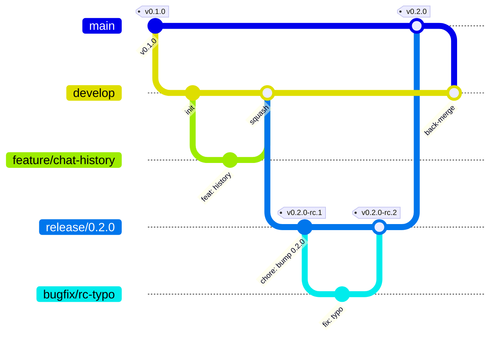

# Git Flow & Release Process

This repository follows **[Git Flow](https://nvie.com/posts/a-successful-git-branching-model/)**
with **release candidates (RC)** and **[Semantic Versioning](https://semver.org/)**. Every rule
here is enforced by automation: GitHub rulesets plus the `Git Flow`, `CI` and `Publish`
workflows. This document says *what* to do. The guardrails reject anything else.

- [1. Branch model](#1-branch-model)
- [2. Versioning & tags](#2-versioning--tags)
- [3. Feature development](#3-feature-development)
- [4. Bug fixing](#4-bug-fixing)
- [5. Release candidate (RC)](#5-release-candidate-rc)
- [6. Production release](#6-production-release)
- [7. Hotfix (urgent production fix)](#7-hotfix-urgent-production-fix)
- [8. Guardrails reference](#8-guardrails-reference)
- [9. Cheat sheet](#9-cheat-sheet)

---

## 1. Branch model



| Branch | Created from | Merges into | Lifetime | Purpose |
|---|---|---|---|---|
| `main` | – | – | permanent | Production. Every commit on `main` is a released version `vX.Y.Z`. |
| `develop` | `main` | – | permanent | Integration branch, always releasable. **Default branch.** |
| `feature/<ticket>-<slug>` | `develop` | `develop` | short | New functionality. |
| `bugfix/<ticket>-<slug>` | `develop` or `release/*` | the branch it came from | short | Non-urgent fixes. |
| `chore/*`, `docs/*`, `refactor/*`, `test/*`, `ci/*` | `develop` | `develop` | short | Non-functional changes. |
| `release/X.Y.Z` | `develop` | `main` (then back-merged to `develop`) | days | Stabilise a release, cut RCs. Bug fixes only. |
| `hotfix/X.Y.Z` | `main` | `main` (then back-merged to `develop`) | hours | Urgent production fix. |

**Merge strategies**

| PR | Strategy | Why |
|---|---|---|
| `feature/*`, `bugfix/*`, … → `develop` / `release/*` | **Squash** | One Conventional Commit per change keeps history clean. |
| `release/*`, `hotfix/*` → `main` | **Merge commit** | Keeps the RC-tagged commits reachable from `main`. Back-merges stay conflict-free. |
| `main` → `develop` (back-merge) | **Merge commit** | Never squash a back-merge. A squash would make `develop` and `main` diverge. |

## 2. Versioning & tags

- Versions follow **SemVer** `MAJOR.MINOR.PATCH`:
  - **MAJOR** for breaking API changes.
  - **MINOR** for backwards-compatible features.
  - **PATCH** for fixes only (hotfixes are always PATCH).
- One version lives in **three places** and must match. `scripts/bump-version.sh` updates all of them:
  `backend/pyproject.toml` (and `uv.lock`), `frontend/package.json`, and a `## [X.Y.Z]` section in `CHANGELOG.md`.
- **RC suffixes exist only on git tags.** The files always hold the final version `X.Y.Z`.

| Tag | Points to | Produces |
|---|---|---|
| `vX.Y.Z-rc.N` | a commit on `release/X.Y.Z` or `hotfix/X.Y.Z` | GitHub **pre-release**, image `ghcr.io/<owner>/<repo>:X.Y.Z-rc.N` |
| `vX.Y.Z` | a commit on `main` | GitHub **release** (latest), images `:X.Y.Z`, `:X.Y`, `:X` (from 1.0), `:latest` |
| *(push to `develop`)* | – | image `:develop` and `:sha-<short>` (edge build, no release) |

Commit messages and PR titles follow **[Conventional Commits](https://www.conventionalcommits.org/)**:
`feat: …`, `fix: …`, `docs: …`, `chore: …`, `refactor: …`, `perf: …`, `test: …`, `build: …`, `ci: …`, `release: …`.
Append `!` to the type for breaking changes, for example `feat!: drop v1 endpoints`.

## 3. Feature development

```bash
git switch develop && git pull
git switch -c feature/42-chat-history

# ... code, with tests ...
make check                              # same gates as CI: lint, types, tests
git commit -m "feat(chat): persist chat history"
git push -u origin feature/42-chat-history

gh pr create --base develop --fill --title "feat(chat): persist chat history"
```

1. Branch from an up-to-date `develop`. Name it `feature/<ticket>-<slug>`.
2. Keep the PR small and focused. Add tests. Update `CHANGELOG.md` under **`## [Unreleased]`**.
3. Open a PR into **`develop`**. The PR title must be a Conventional Commit, because it becomes the squash commit.
4. Required checks: **`CI passed`**, **`Git Flow rules`**, **`PR title`**. Also get one approving review.
5. **Squash & merge.** The branch is deleted automatically.
6. The push to `develop` publishes `ghcr.io/<owner>/<repo>:develop` for testing.

## 4. Bug fixing

Which flow applies depends on **where the bug lives**:

| Bug found in… | Branch from | PR into | Flow |
|---|---|---|---|
| `develop` (not released yet) | `develop` | `develop` | Same as a feature: `bugfix/<ticket>-<slug>`, squash merge. |
| A running **release candidate** | `release/X.Y.Z` | `release/X.Y.Z` | See [RC fixes](#rc-fixes) below. A new RC follows. |
| **Production** (urgent) | `main` | `main` | [Hotfix](#7-hotfix-urgent-production-fix). |
| Production (can wait) | `develop` | `develop` | Normal bugfix. It ships with the next release. |

```bash
git switch develop && git pull
git switch -c bugfix/57-empty-chat-crash
git commit -m "fix(chat): handle empty assistant reply"
gh pr create --base develop --fill
```

Every bug fix comes with a regression test that fails without the fix.

## 5. Release candidate (RC)

### Cut the release branch

Freeze features: create `release/X.Y.Z` from `develop` and set the version.

```bash
git switch develop && git pull
git switch -c release/0.2.0

scripts/bump-version.sh 0.2.0          # pyproject.toml, uv.lock, package.json
# CHANGELOG.md: rename "## [Unreleased]" to "## [0.2.0] - YYYY-MM-DD", then add a new empty [Unreleased]
git commit -am "chore(release): prepare 0.2.0"
git push -u origin release/0.2.0
```

From now on, `release/0.2.0` takes **bug fixes only**. New features keep landing on `develop` for the next release.

### Tag RC 1

```bash
git tag -a v0.2.0-rc.1 -m "Release candidate 0.2.0-rc.1"
git push origin v0.2.0-rc.1
```

The **Publish** workflow then:

1. **Validates the tag.** The format must be `vX.Y.Z-rc.N`, the commit must be on `release/0.2.0`, and the versions plus the CHANGELOG entry must match.
2. Runs the full **CI** gate on that exact commit.
3. Builds the multi-arch image (`linux/amd64`, `linux/arm64`) **without cache**, with SBOM and provenance, and pushes `:0.2.0-rc.1`.
4. Attaches a signed **build-provenance attestation**. Verify it with `gh attestation verify oci://ghcr.io/<owner>/<repo>:0.2.0-rc.1 -R <owner>/<repo>`.
5. Creates a GitHub **pre-release** with the CHANGELOG section and the `docker pull` command.

Deploy `:0.2.0-rc.1` to staging/QA and test it.

### RC fixes

```bash
git switch release/0.2.0 && git pull
git switch -c bugfix/61-rc-stream-timeout
git commit -m "fix(llm): extend stream timeout"
gh pr create --base release/0.2.0 --fill     # squash merge

git switch release/0.2.0 && git pull
git tag -a v0.2.0-rc.2 -m "Release candidate 0.2.0-rc.2"
git push origin v0.2.0-rc.2
```

Repeat until QA signs off. Each RC is immutable: never move or re-push a tag. Cut `rc.N+1` instead.
To bring RC fixes to `develop` early, open a PR `release/0.2.0 → develop` with a merge commit (optional).
The back-merge after the production release brings them in anyway.

## 6. Production release

Release the **exact commit that QA approved** as the last RC.

```bash
# 1. Merge the release branch into main (merge commit, not squash)
gh pr create --base main --head release/0.2.0 --title "release: 0.2.0" \
  --body "Promotes v0.2.0-rc.2 to production."
```

The `Git Flow rules` check confirms that the branch is `release/X.Y.Z`, the three versions equal `X.Y.Z`, and `CHANGELOG.md` has the section.
Once checks pass and the PR is approved, **merge with a merge commit**.

```bash
# 2. Tag the merge commit on main
git switch main && git pull
git tag -a v0.2.0 -m "Release 0.2.0"
git push origin v0.2.0
```

Publish validates that `v0.2.0` sits on `main`, re-runs CI, and pushes `:0.2.0`, `:0.2`, and `:latest` (plus `:0` from 1.0.0 on).
It then creates the **GitHub release** marked as latest.

```bash
# 3. Back-merge main into develop (merge commit)
gh pr create --base develop --head main --title "chore(release): back-merge 0.2.0 into develop" \
  --body "Brings release commits and RC fixes back to develop."
```

Merge it with a **merge commit**. The `release/X.Y.Z` branch is **kept**: the ruleset protects release and hotfix branches from deletion, so they remain an audit trail next to their tags.

## 7. Hotfix (urgent production fix)

```bash
git switch main && git pull
git switch -c hotfix/0.2.1
git commit -m "fix(api): reject oversized payloads"      # include a regression test
scripts/bump-version.sh 0.2.1
# CHANGELOG.md: add "## [0.2.1] - YYYY-MM-DD"
git commit -am "chore(release): prepare 0.2.1"
git push -u origin hotfix/0.2.1

# Optional but recommended: verify on staging first
git tag -a v0.2.1-rc.1 -m "Hotfix candidate 0.2.1-rc.1" && git push origin v0.2.1-rc.1

gh pr create --base main --head hotfix/0.2.1 --title "release: 0.2.1 (hotfix)"
# merge (merge commit) → tag v0.2.1 on main → back-merge main into develop, as in §6
```

If a `release/*` branch is open while you hotfix, also merge the hotfix into it, or rebase that release onto it.
That way the next release does not regress the fix.

## 8. Guardrails reference

| Guardrail | Where | Enforces |
|---|---|---|
| Ruleset **`main`** | GitHub | PR required (1 approval, conversations resolved), status checks `CI passed` / `Git Flow rules` / `PR title` (branch must be up to date), no force-push, no deletion, merge-commit only |
| Ruleset **`develop`** | GitHub | PR required (1 approval), same status checks, no force-push, no deletion, squash or merge |
| Ruleset **`release & hotfix branches`** | GitHub | no force-push, no deletion |
| Ruleset **`release tags`** | GitHub | `v*` tags can only be created, moved or deleted by admins (every bypass is audited); everyone else is blocked |
| `Git Flow rules` | `.github/workflows/gitflow.yml` | Allowed source → target combinations (table in §1) and version consistency for PRs into `main` |
| `PR title` | `.github/workflows/gitflow.yml` | Conventional Commit PR titles |
| `CI passed` | `.github/workflows/ci.yml` | ruff lint + format, mypy `--strict`, pytest (≥ 85 % coverage), oxlint + eslint, prettier, vue-tsc, vitest, Vite build, Docker build + smoke test, actionlint + zizmor |
| Tag validation | `.github/workflows/publish.yml` | `vX.Y.Z` must be on `main`, `vX.Y.Z-rc.N` must be on `release/X.Y.Z` or `hotfix/X.Y.Z`, and versions must match |
| Supply chain | `publish.yml`, `security.yml`, `dependabot.yml` | Actions pinned to commit SHAs, release images built without cache, SBOM + provenance + attestation, CodeQL, dependency review, weekly Dependabot PRs into `develop` |
| Local hooks | `.pre-commit-config.yaml` | Same linters before each commit (`make hooks`) |

Admins can bypass PR requirements in an emergency, for example to merge their own PR without a second reviewer.
Every bypass is recorded in the ruleset insights.

## 9. Cheat sheet

| I want to… | Command(s) |
|---|---|
| start a feature | `git switch -c feature/<id>-<slug> develop` → PR into `develop` (squash) |
| fix a bug in develop | `git switch -c bugfix/<id>-<slug> develop` → PR into `develop` (squash) |
| cut a release | `git switch -c release/X.Y.Z develop` → `scripts/bump-version.sh X.Y.Z` → CHANGELOG → push |
| publish an RC | `git tag -a vX.Y.Z-rc.N -m "…" && git push origin vX.Y.Z-rc.N` (on `release/X.Y.Z`) |
| fix an RC | `git switch -c bugfix/<slug> release/X.Y.Z` → PR into `release/X.Y.Z` → next RC tag |
| ship to production | PR `release/X.Y.Z → main` (merge commit) → `git tag -a vX.Y.Z` on `main` → PR `main → develop` (merge commit) |
| hotfix production | `git switch -c hotfix/X.Y.Z main` → fix + bump → (RC) → PR into `main` → tag → back-merge |
| check versions | `scripts/check-version.sh X.Y.Z` |
